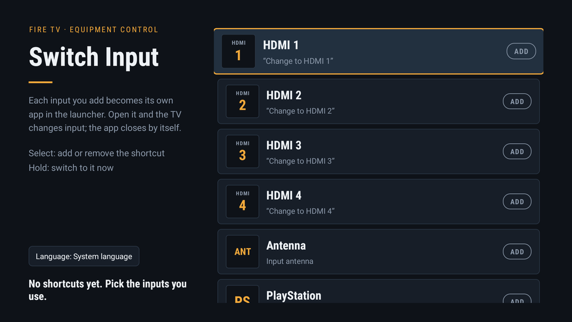
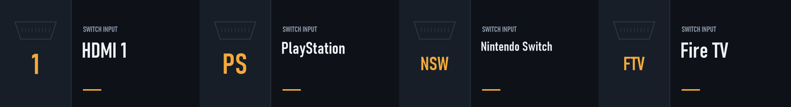
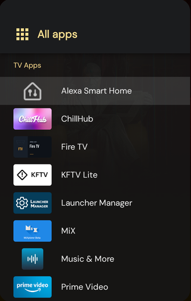

# Switch Input for Fire TV

Turn each TV input configured in Fire TV's **Equipment Control** into its own app in the
launcher. Open "PlayStation" and the TV switches to HDMI 2, exactly as if you had said
"Alexa, change to PlayStation", but without talking to the remote. The app closes itself,
so you are straight back in your launcher.



## Why

Fire TV devices can control the TV they are plugged into: once you set up your TV and
other equipment under **Settings → Equipment Control**, the stick knows how to switch the
TV's inputs over HDMI-CEC or the remote's infrared blaster. Whether you can *use* that
directly depends on the device. Some models and firmware versions offer an Inputs row or a
button for it; others (this Fire TV Stick 4K Max on Fire OS 8 among them) keep the feature
but only expose it through Alexa: you have to hold the voice button and say
"Change to PlayStation" every time.

Switch Input gives that function back to the remote. It reads the equipment you already
configured in Settings, lets you pick which inputs you want, and turns each one into a
regular TV app in your launcher. Opening the app sends Fire TV's Equipment Control engine
the same "select input" instruction the Alexa cloud would send, then closes itself.

### Why root is needed

The input list and the switch command live inside Fire TV's own Equipment Control app,
which is a privileged system component:

- Its list of configured equipment is stored in a private database that other apps cannot
  read. Switch Input reads it as root to know which inputs exist and which TV endpoint to
  address.
- The component that executes an input switch only accepts instructions from the system
  (Alexa's directive broker). Switch Input delivers the same instruction as root, because
  the normal permission to do so is reserved for Amazon-signed apps.

Nothing else is changed on the stick: no system files are modified, and root is only used
for those two operations plus installing the small per-input shortcut packages.

## What you get

- **One app per input.** HDMI 1–4, antenna, and any equipment you added in Fire TV
  Settings (PlayStation, Nintendo Switch, …) each become a normal TV app with a banner.
- **Works with any launcher.** Projectivy, the stock Fire TV home, or anything that lists
  TV apps.
- **No cloud round trip.** The switch is handled on the stick by Fire TV's own Equipment
  Control engine, through the same path Alexa uses.



## Requirements

- A Fire TV Stick with **root** (Magisk); see [Why root is needed](#why-root-is-needed).
  Tested on a Fire TV Stick 4K Max, Fire OS 8.1.
- **Equipment Control** set up in Fire TV Settings, so "Alexa, change to …" already works.
- ADB access to the stick, to install the app once.

## Install

Build the APK (see the developer notes below) or take a release build, then:

```bash
adb connect <fire-tv-ip>:5555
adb install -r app-debug.apk
```

Magisk asks for root the first time the app runs; grant it.

## Use

1. Open **Switch Input** from your launcher. It lists every input Fire TV knows about.
2. **Select** an input to add it to the launcher; select again to remove it.
3. **Hold** Select on an input to switch to it right away.

Added inputs show up next to your other TV apps:



Open one and the TV switches input while a short "Switching to …" toast shows; the app
closes by itself. New equipment added in Fire TV Settings appears in the list the next time
you open Switch Input.

## Good to know

- Each shortcut is a tiny separate package. Uninstalling Switch Input does not remove
  shortcuts you added; remove them from the picker first.
- Everything runs locally on the stick. Nothing is sent anywhere.

## For developers

How it works, how to build and deploy, and what was found inside Fire OS to make this
possible: see [DEVELOPMENT.md](DEVELOPMENT.md).
